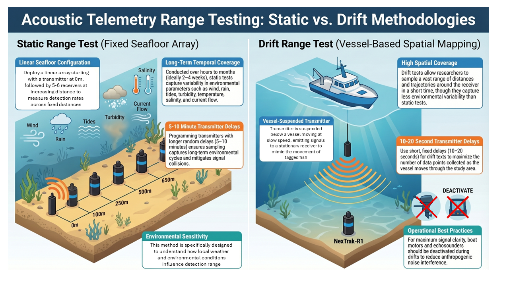

# RangeR : Analysis tools for acoustic receiver detection range 

The *RangeR* package was designed to reduce the complexity of calculating the effective range of Innovasea acoustic receivers when deployed in short-term drift or long-term static tests. The package contains a series of reproducible example R scripts guiding the user through the analysis workflow for drift and static tests along with example data.  In addition to script based functions, RangeR also contains the shiny apps *DriftR* and *FixRangeR* (coming soon) allowing users to analyse data in a web-app interface providing rapid assement of receiver range. 

The package also conatins functions which can be useful when working with acoustic telemetry equipment in the field including receiver separation calculations, finding closest neighbouring receiver, geodetic to utm conversions and more.

## Overview

Effective range testing is a critical step when conducting any acoustic telemetry study. Range testing can be classified into two broad categories, static test which cover long time periods and capture variability in environmental conditions which may impact receiver performance, and drift range tests which are short in duration and have greater spatial coverage compare to static tests. For more information on conducting a range test please review Innovasea's [field guide to range testing](https://go.innovasea.com/innovasea_range_test_field_guide.pdf)




### Mobile (Drift) Range Tests

Mobile range tests, often referred to as drift tests, involve deployment of a stationary receiver and moving a transmitter below a vessel within the detection field. Drift tests are often short-term and do not cover a wide range of environmental conditions which can impact detection range. While not incorporating environmental variation, drift range tests can capture a greater range of distances between the receiver and transmission source.  

Steps to calculate Drift Range Test using a VR100 logfile

1.  parse logfiles from stationary receiver using *FathomR::parse_fathom_files()*
2.  select devices used in the test using *select_devices()*
3.  calculate the start and end time of the deployment using *get_deployment_time()*
4.  create a station vector containing Long,Lat
5.  select the range test Full_ID using *select_range_transmitter(det)*
6.  extract transmission from the VR100 log using *extract_VR100_transmission*
7.  extract the detection data from the stationery receiver using *drift_detections()*
8.  compile drift analysis using *compile_drifts()*
9.  plot drift test results using *plot_drift_results()*


### Static Range Tests

Static range tests typically span longer time scales than mobile range tests but are typically limited to sampling a very small number of distances between receivers and the transmission source. The benefit of static tests is their ability to capture a greater range of enviornmental variability.  

Steps to calculate Static Range Test

1.  parse logfiles from stationary receiver using *FathomR::parse_fathom_files()*
2.  prepare receiver deployment metadata for distance calculations *prepare_distance_df()*
3.  calculate distances between all possible combinations of deployed receivers *receiver_separations()*
4.  calculate the start and end time of the deployment using *get_deployment_time()*
5.  create a dataframe (tibble) with transmitter metadata ('Full ID', model)
6.  calculate detection range using *calculate_range()*


## Analysis Workflows

Detailed workflow vignettes are now available covering the following topics: 

Planned topics:

- Drift range test workflow
  - Transmissions captured using a VR100 
  - Transmission reconstructed from a GPS tracklog 
- Static range test workflow
  


## Main Functions

### Select Devices
`select_devices()`

Selection of the stationary receiver which defines the detection data and the device (VR100) used to record the transmission of acoustic signals

### Get Deployment Time
`get_deployment_time()`

A function designed to automatically calculate the start and the end of the stationary receiver deployment using the in-built tilt sensor. When performing range tests using VR2W receivers, users define start and end times manually. 

### Select Range Transmitter
`select_range_transmitter`

The function scans the transmission data from the VR100 identified by select_devices() and allows the user to define the full ID code of the transmitter being used in the range test. 

### Extract (VR100) Transmissions
`extract_VR100_transmission`

Creates a dataframe from the VR100 log containing detections filtered by the full ID code defined in the `select_range_transmitter` function.  


### Drift Detections
`drift_detections()`

Creates a dataframe of the detections matching the full ID defined by `select_range_transmitter` function on the receiver defined by the `select_devices` function. 

### Compile Drifts
`compile_drifts()`

Combines transmission data defined by the `extract_VR100_transmission` function and the corresponding detection data defined by the `drift_detections` function. Data is combined based on time matching using a time buffer parameter defined by the user. 


# Installation

- **R** `RangeR` requires`R` version ≥ 4.1 which can be installed from **R-project [`R`](https://www.r-project.org)**. If you are unsure of your R version, try `R.version.string` from the `R` console. To update R from within RStudio, install and load the `installr` package and run `updateR()`

- **Install remotes**
``` 
# Install the remotes package
install.packages("remotes")

# Use remotes to install the FathomR package from github repo
remotes::install_github("Fish-Tracking-Data-Team/RangeR", 
                        build_vignettes = TRUE,
                        dependencies = TRUE)
```
